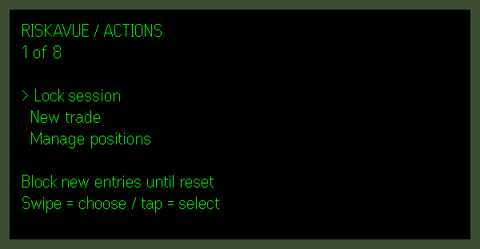
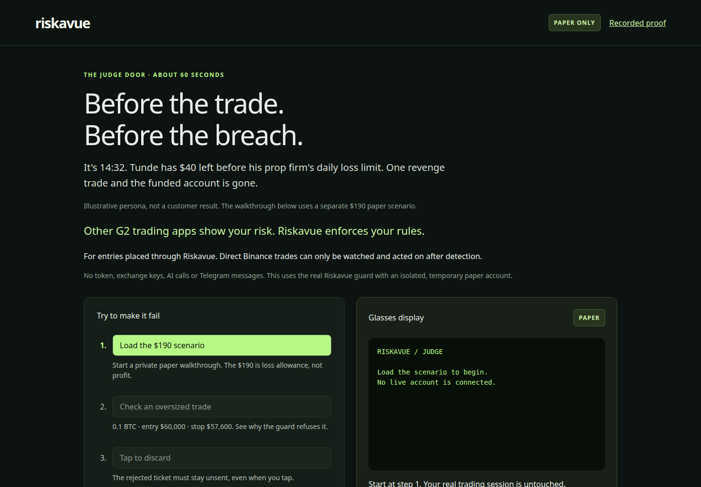
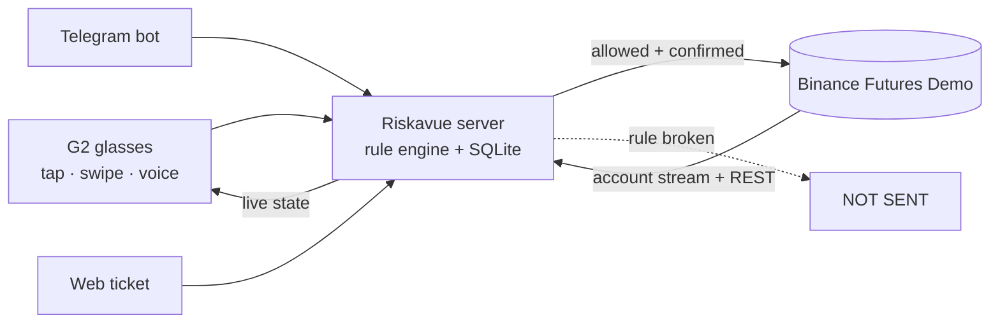

<div align="center">


# Riskavue

**Other G2 trading apps show your risk. Riskavue enforces your rules.**

A prop-firm rule guard for Even Realities G2 smart glasses. It checks every trade against the trader's limits *before* it reaches the exchange.

[**Live app**](https://riskavue.up.railway.app) · [**60-second judge walkthrough**](https://riskavue.up.railway.app/judge) · [**Demo video**](https://youtu.be/uzFlrZ7Rdxg) · [Technical reference](docs/TECHNICAL.md)


</div>

---

## The problem

> It's 14:32. Tunde has **$40 left** before his prop firm's daily loss limit. He has just taken a loss and wants it back with one big trade. One revenge trade, and the funded account is gone.
>
> <sub>Illustrative persona, not a customer testimonial or a claim about every firm's rules.</sub>

Prop firms give traders capital under strict rules: a daily loss limit, a maximum drawdown, and sometimes a cap on trades or on losses in a row. Break one rule once and the account is closed. Topstep's official 2025 disclosure says **16.8% of initiated Trading Combines completed successfully** ([source](https://www.topstep.com/social-media-disclosure), checked 25 Nov 2026). That figure counts Combines, not individual traders, and says nothing about why traders fail or about Riskavue.

Most tools *show* traders their risk. In the moment that matters, showing isn't enough.

## What Riskavue does

| | |
|---|---|
| 👓 **Glance** | The G2 shows the loss allowance left today, trades left, losses in a row and the reset time, without leaving the charts. |
| 🛑 **Guard** | Every trade placed through Riskavue (glasses, Telegram or web ticket) is checked against the whole account first. A trade that would break a rule is **not sent**. |
| ✅ **Confirm** | An allowed trade needs one tap. It goes in as a post-only limit entry with a protective stop. |
| 🔒 **Lock** | When a limit is reached, new trades lock until the reset. The lock survives restarts, and protective stops stay in place. |
| 👀 **Watch** | Trades sent directly to Binance can't be blocked, so they are watched: pending orders can be cancelled and fills are reported honestly. |
| 💬 **Reach** | A Telegram bot gives `/status`, `/lock`, `/review` and confirmations when the glasses are off. |
| 🎙️ **Speak** (optional) | Voice commands through Deepgram, such as "lock me" or "close all". Every write still needs a tap. |
| 📝 **Review** | A short end-of-session review by Claude, based on the decision log. The AI never makes trade decisions. |

<p align="center">
  
  <br><sub>The actions menu as rendered for the G2 (576 × 288, monochrome)</sub>
</p>

## Try it in 60 seconds

Open **[riskavue.up.railway.app/judge](https://riskavue.up.railway.app/judge)**. No login, no keys, no real account.

1. **Load the $190 scenario.** It creates a private, temporary paper account.
2. **Check an oversized trade.** Expect **NOT SENT**, with zero orders.
3. **Tap to discard.** No order appears.
4. **Trigger two losses**, then try another trade. Expect **STILL LOCKED**.
5. **See the Telegram `/status` preview** and the three-line review.
6. **Scroll to "Proof that could have failed"** for timestamped Binance Demo receipts.

The judge page uses the real rule engine with an isolated paper account. It never touches the owner's live session, Binance, Telegram or the AI providers.

<p align="center"></p>

## Proof from a real exchange

These runs used **Binance USDⓈ-M Futures Demo** on 24 November 2026. They are not real-money trades.

| UTC time | Recorded outcome |
|---|---|
| 20:59:41 | Oversized ticket rejected, **0 exchange orders** |
| 20:59:45 | Allowed ticket waited for confirmation |
| 20:59:53 | Entry #28694211519 and protective stop accepted |
| 20:59:54 | Repeated confirmation **did not duplicate** the order |
| 21:00:00 | Cancellation confirmed by Binance |
| 21:00:05 | Account clean: 0 positions, 0 orders |
| 21:14:01 | An outside order (#28694222135) placed directly on Binance filled |
| 21:14:03 | The watcher honestly reported "already filled" |
| 21:14:08 | Confirmed reduce-only close filled |
| 21:14:13 | Account clean again |

The sanitized receipts are in `.artifacts/`. `scripts/build-proof.ts` builds the secret-free `app/src/proof.json` shown on the judge page, with SHA-256 hashes of the source files. These are recorded test results, not an independent audit.

## How it works



1. The server keeps a fresh copy of the account (balance, positions and orders) from Binance.
2. Each trade request is checked against the trader's rules: daily loss, maximum loss, trades per session and losses in a row. The check includes fees, slippage and the distance to the stop.
3. If the trade passes, the trader confirms with a tap. The server checks again, then sends the order exactly once.
4. Results, locks and decisions are saved, so nothing is lost or repeated after a restart.

### Safety rules built in

- **Stale data pauses everything.** If the account hasn't refreshed for 15 seconds, the balance is hidden and actions stop.
- **Actions run once.** Double taps and repeated confirmations can't duplicate an order.
- **"Cancelled" appears only after Binance confirms it.** No status is shown optimistically.
- **Locks survive restarts**, and a lock never removes protective stops.
- **Unknown history is disclosed.** If the day's starting balance is unknown, the limit is labelled as estimated.

## Rule presets

Choose custom rules, or presets modelled on **FTMO 2-Step**, **Topstep $50K Combine**, **The5ers** and **HyroTrader**. Each preset shows its assumptions and official source. The presets copy each firm's published rules; they are not integrations with the firms. Always confirm your own account's tier, loss type and reset time.

## Tech stack

| Layer | Tools |
|---|---|
| Glasses | Even Hub SDK 0.0.16 (G2, 576 × 288), official simulator |
| App | TypeScript and Vite: one web page for the glasses and the browser companion |
| Server | Node.js 24 (built-in SQLite), Express, WebSocket (`ws`), Zod |
| Exchange | Binance USDⓈ-M Futures **Demo** (REST plus user and market streams) |
| Integrations | Telegram (grammY), Deepgram Nova-3 (speech), Claude (review) |
| Hosting | Railway, deployed by GitHub Actions after the checks pass |

## Run locally

Requires **Node.js 24.4+**.

```bash
git clone https://github.com/dimka90/riskavue.git
cd riskavue
npm ci
cp .env.example .env      # paper mode needs no keys
npm run dev               # http://127.0.0.1:5173
```

Paper mode is the default and uses synthetic data only. Click **Load $190 scenario**, then check a ticket (quantity `0.1`, limit `60000`, stop `57600`) to see the rejection.

```bash
npm test                  # 72 rule, persistence and action-safety tests
npm run build && npm start
npm run simulate          # official Even Hub simulator
```

Binance Demo, Telegram, Deepgram and Claude are optional and are configured in `.env`. [docs/TECHNICAL.md](docs/TECHNICAL.md) covers the settings, the voice and Telegram commands, the G2 controls, deployment and every test script.

## Honest boundaries

- **A guard for trades placed through Riskavue, and a watcher for trades placed directly on Binance.** A filled outside trade can't be undone; Riskavue can only report it and offer to close it.
- **Demo exchange only.** No real-money trading has been done.
- **Stops can't guarantee the realised loss** in a fast market gap.
- **Not yet tested on physical G2 glasses.** All glasses testing used the official simulator.
- Full list: [What was actually run / not done](docs/TECHNICAL.md#what-was-actually-run--not-done).

## Project layout

```
app/       G2 + browser companion (glasses rendering, controls, judge page)
server/    rule engine, Binance adapter, Telegram, integrations, SQLite store
shared/    types and display text used by both sides
tests/     unit, integration and browser tests
scripts/   proof builder, exchange checks, demo recording
research/  prop-firm rules and provider research
docs/      technical reference
```

## Built for

**Heads Up: Even Realities Hackathon** on DoraHacks. Main track: Exchanges & Stocks. Built during the hackathon, starting 24 November 2026.

**AI disclosure:** AI coding tools (Codex and Claude Code) generated and edited much of the code, tests and documentation under the owner's direction. The owner directed the product, made the decisions and reviewed the results. Automated tests and recorded evidence don't replace human review. The G2 bridge follows the [official Even Hub minimal example](https://github.com/even-realities/evenhub-templates/tree/main/minimal); no competitor code was copied.

<div align="center"><sub>Built by <a href="https://github.com/dimka90">dimka90</a> · Blockfuse Labs</sub></div>
